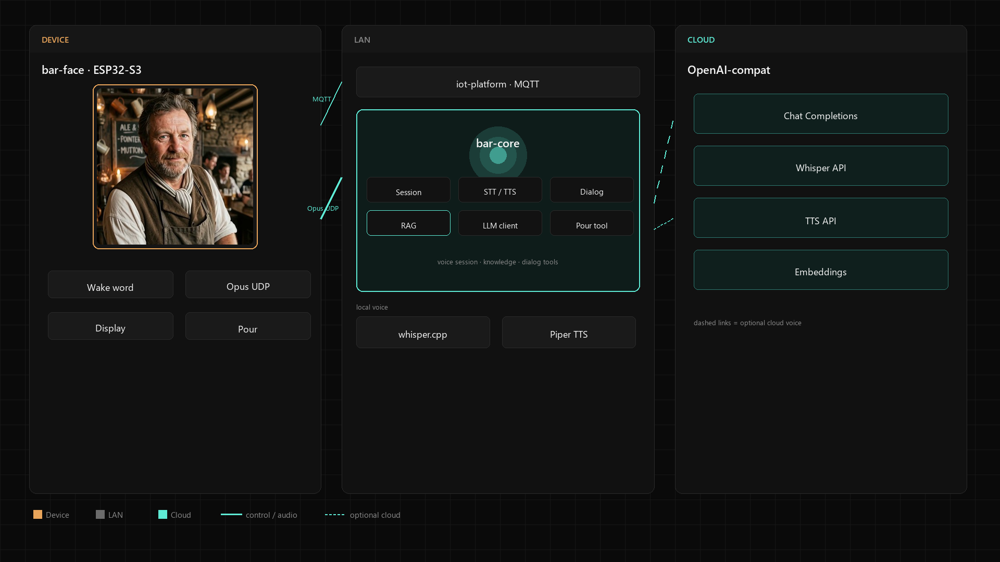
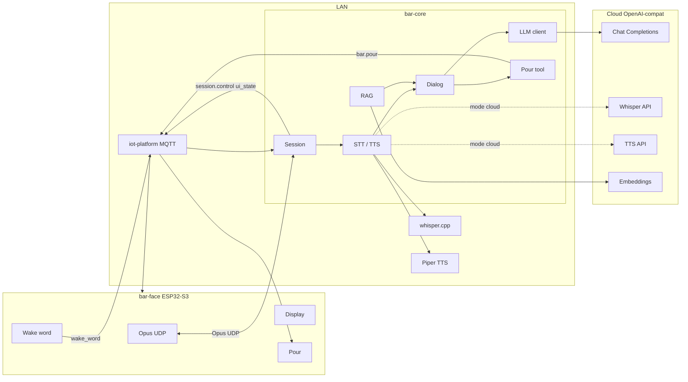

# Architecture

## Overview

*Columns: **Device** / **LAN** / **Cloud**. Style inspired by [cogitor.dev](https://cogitor.dev) — dark grid, amber device accent, cyan `bar-core` hub (Session · STT/TTS · Dialog · **RAG** · LLM · Pour tool). Source SVG: [bar-tech-architecture.svg](assets/bar-tech-architecture.svg); regenerate PNG via `python docs/assets/render_architecture.py`.*

Mermaid source (editable)

## Voice session flow

1. `bar-face` detects wake word → MQTT event `wake_word`
2. `bar-core` (iot-platform external plugin) creates a UDP session
3. Downlink RPC `cogitor.session.control` / `action: start` with `server_ip`, `udp_port`, `udp_session_id`
4. Device streams Opus uplink; on end-of-speech → STT → RAG → LLM → TTS → Opus downlink
5. Desired attributes drive UI: `thinking` / `speaking` / `idle`
6. Intent «налей» → dialog tool `pour` → RPC `bar.pour` (stub until hardware phase)

## Component boundaries

| Component | Owns | Does not own |
|-----------|------|--------------|
| bar-face | Mic/spk, wake word, display, UDP client, pour stub | LLM, STT/TTS, RAG |
| iot-platform | Device registry, MQTT ACL, rules bus | Business dialog |
| bar-core | Sessions, STT/TTS, RAG, LLM, pour tool | Firmware, broker |

## Contracts

- [mqtt-protocol.md](mqtt-protocol.md)
- [udp-audio.md](udp-audio.md)
- [pour-protocol.md](pour-protocol.md)
